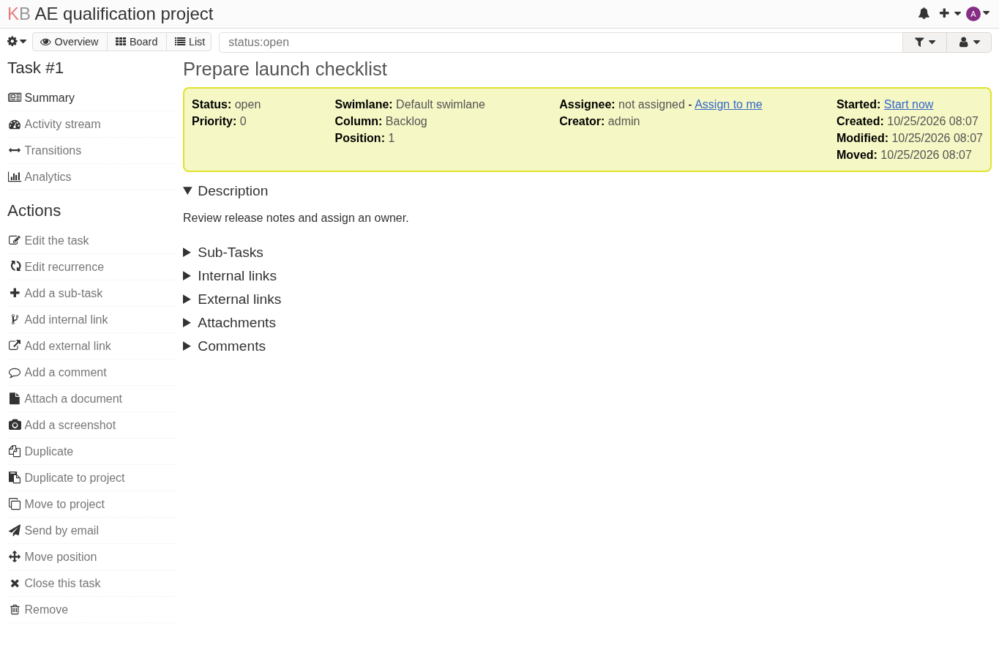
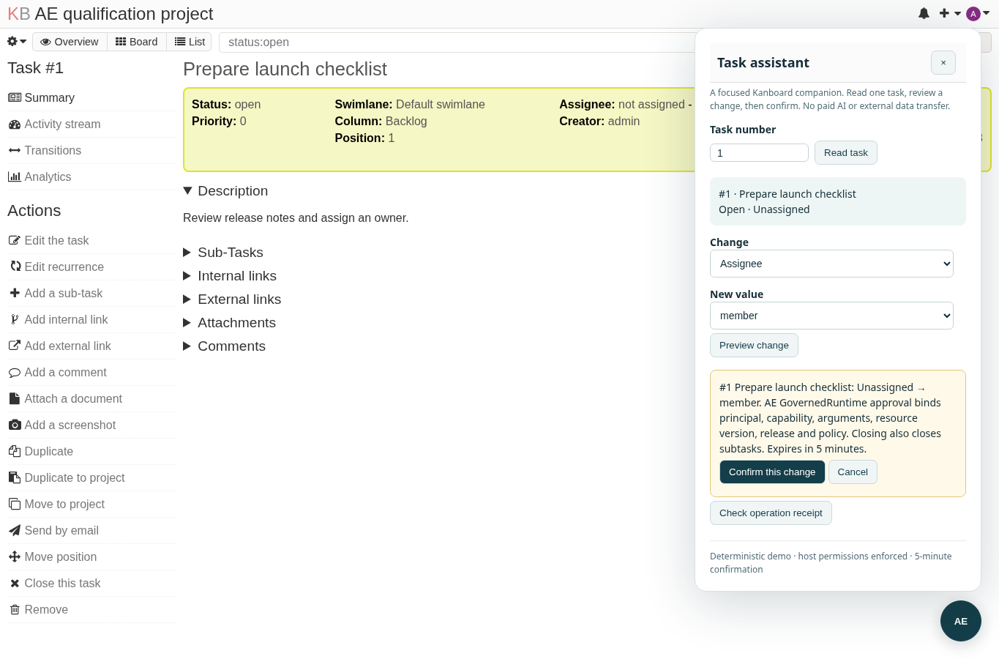

# Kanboard Agentic

Kanboard’s original PHP task board, enhanced with a native draggable assistant powered by Agentic Everything’s shared `GovernedRuntime` and `ToolBroker`.

## Bounded capabilities

- Read one task under the current user’s native project permissions.
- Preview and explicitly confirm task status or assignee changes.
- Preserve original task UI, roles, membership, CSRF and host-owned SQLite receipts.
- Reject stale, repeated, cancelled and unauthorized confirmations; fail closed after runtime restart.
- Administrator enable/disable controls in **Settings → Agentic Everything**.

The included provider is explicitly a **deterministic demo**, not a paid AI service. A real caller path through AE’s `FileModelProvider` is available; no model API or external deployment is configured.

## Start and develop

See the [integration guide](plugins/AgenticEverything/README.md) for runtime prerequisites, launcher commands, architecture, trust boundaries, configuration and recovery. The [original upstream README](docs/UPSTREAM_README.md) preserves Kanboard documentation and links.

## Actual acceptance

Pinned original: Kanboard **1.2.56**, commit `e197e71af4ff9f371b931ab0338b2b41827e6394`. Adaptation recipe: `kanboard-upstream@1.0.4`.

The real AE assessment → plan → approval → original baseline → apply → delivery → delivery-check lifecycle completed on 2026-10-25. All six scoped gates passed, with **20 actual browser/runtime checks**, and **53 native tests / 475 assertions** independently on original and candidate. Static verification alone correctly reported execution not run; acceptance uses the actual delivery evidence.

- [Accepted delivery bundle](docs/agentic-evidence/delivery/manifest.json)
- [Independent delivery-check result](docs/agentic-evidence/delivery-check.json)
- [Acceptance scope and limitations](docs/agentic-evidence/README.md)

| Original host | Governed assistant |
|---|---|
|  |  |

[Actual narrow-screen screenshot](docs/agentic-evidence/screenshots/candidate-narrow.png)

## License

Kanboard retains its original [MIT license](LICENSE). The integration has its own [MIT license](plugins/AgenticEverything/LICENSE). Bundled upstream components retain their licenses, including PHPQRCode’s LGPLv3; see [third-party notices](plugins/AgenticEverything/THIRD_PARTY_NOTICES.md). No upstream attribution is removed.
